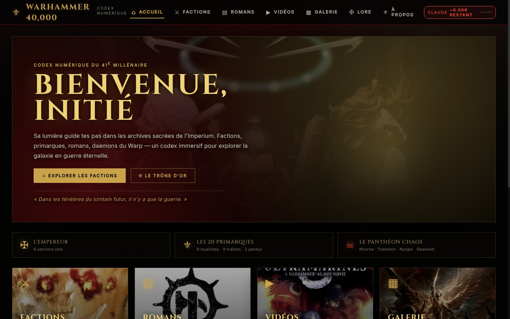
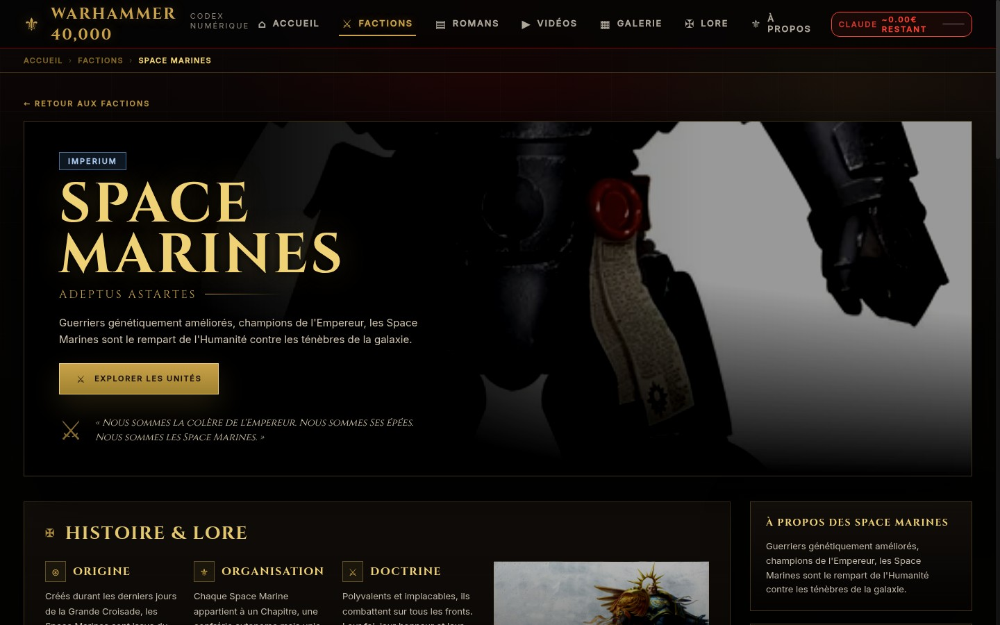
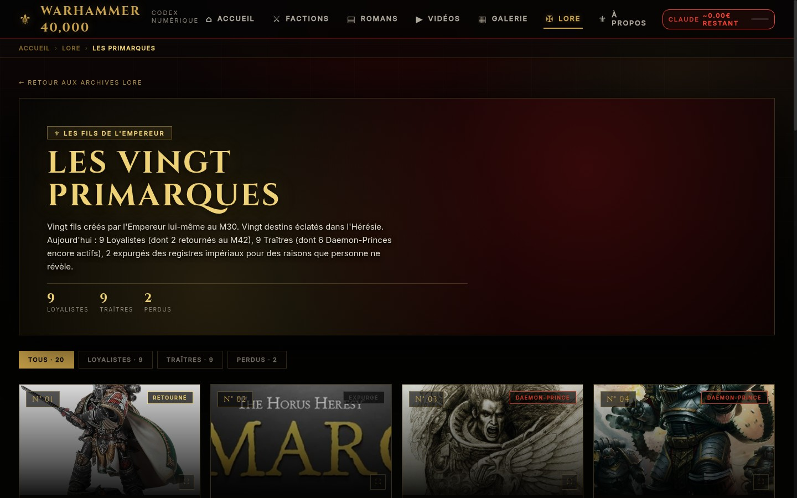
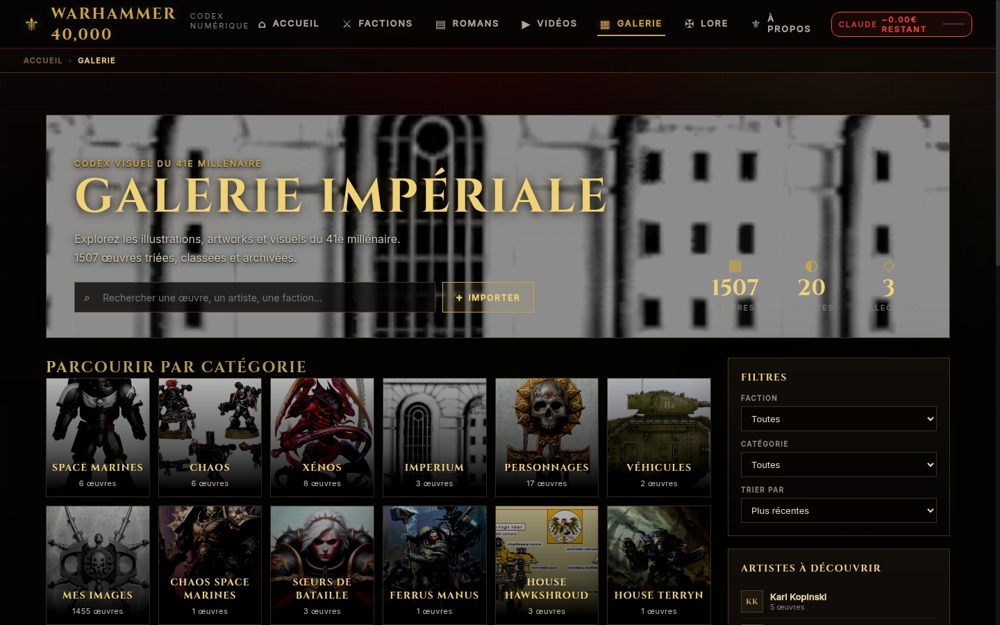
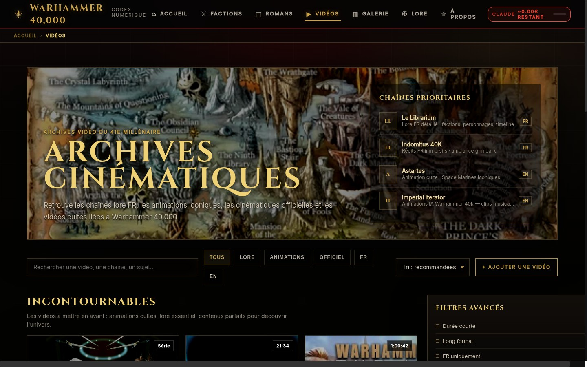
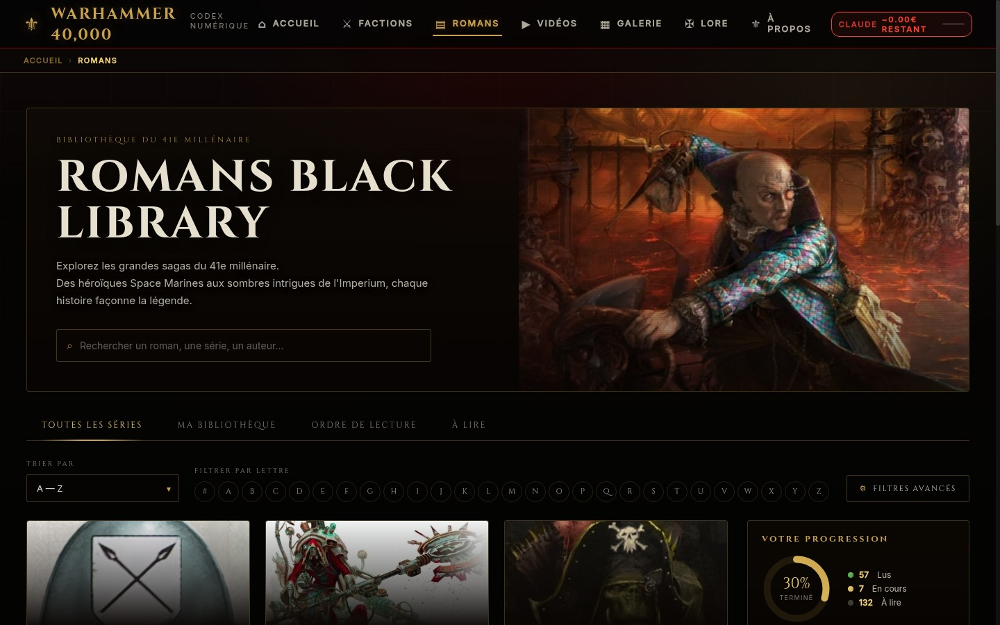

# Warhammer 40K Codex

[](https://claude.com/claude-code)
[](https://chat.openai.com)
[](https://angular.dev)
[](https://nestjs.com)
[](LICENSE)

> Codex personnel immersif lore-first sur l'univers de Warhammer 40000 : factions, sous-factions (chapitres SM, légions Chaos, régiments AM, etc.), unités, romans Black Library, vidéos lore, galerie d'art.
>
> **100% du code écrit en pair-programming avec [Claude Code](https://claude.com/claude-code).** Direction artistique humaine + premières maquettes UX par [ChatGPT](https://chat.openai.com), implémentation Claude. Voir [Crédits IA](#crédits-ia).



## Aperçu

| | |
|---|---|
|  |  |
| **Faction Detail** — hero image-first, breadcrumb, lore en sections | **Les 20 Primarques** — 9 loyalistes / 9 traîtres / 2 expurgés |
|  |  |
| **Galerie Impériale** — 1500+ œuvres, catégories, multi-tag user | **Archives Cinématiques** — chaînes prioritaires, filtres, import oEmbed |


*Romans Black Library — 38 séries, progression de lecture, ordre canonique*

## Pourquoi

Dev Java/web depuis 2005, j'utilise ce projet pour explorer **Claude Code** sur un stack frontend que je ne pratique pas au quotidien : **Angular 19 + NestJS**.

Le sujet (W40K) est volontairement riche en lore + visuel pour pousser sur les enjeux UX : navigation hiérarchique, cards image-first, fil narratif central, intégration de sources externes (Wikipedia/Fandom, Reddit, 40k.gallery).

Mon rôle : direction artistique + cadrage du besoin.
Le rôle de Claude : poser le code, expliquer chaque choix, itérer.

En amont du code, [ChatGPT](https://chat.openai.com) a aidé à générer les premières maquettes UX et schémas de pages — point de départ visuel pour l'identité gothique noir/or.

## Fonctionnalités

- **Pages** : Dashboard, Factions, Faction Detail, SubFaction Detail, Unit Detail, Romans, Vidéos, **Jeux vidéo** (jeux à venir puis déjà sortis, données vérifiées en ligne dans `frontend/public/jeux-data/jeux.json` ; un jeu à venir dont le jour de sortie annoncé est atteint passe automatiquement en tête de « Déjà sortis », à compléter ensuite dans le fichier avec son vrai résumé et ses plateformes), Galerie, Lore Hub (sommaire `/lore` : carte « Concepts & Lieux » au titre exact ; à 320 px, marge intérieure du hero réduite sous 600 px et titre dès 32 px, sans rognage — L152 ; les compteurs des cartes (fiches, dieux et daemons notables, organisations et fonctions, concepts, événements et ères, pièces, vaisseaux, dieux-machines, figures) et la répartition des Primarques de sa description sont calculés à partir des mêmes données que les pages — API, et `HOT_ZONES` de `lore-galaxy.data.ts` pour les hot zones et failles warp de la carte galactique ; si une liste est indisponible, sa carte n'affiche aucun chiffre ; gardé par `lore-hub/lore-hub-l151.spec.ts` — L151), Empereur (en-tête lisible dès 320 px : marge intérieure de 20 px sous 800 px, titre mesuré au bandeau, voile uni sous le texte pour un sous-titre à 4,5:1 au moins ; gardé par `lore-emperor-l153-entete.e2e.spec.ts` — L153 ; sections : texte en pleine largeur et deux colonnes seulement quand l’illustration du wiki est là, paragraphes bornés à 70ch, gardé par `lore-emperor-l154-sections.e2e.spec.ts` — L154), Primarques (en-têtes lisibles dès 320 px : liste avec marge intérieure de 16 px sous 760 px, fiche avec la seule gouttière de la mise en page (16 px sous 680 px, 34 px de 681 à 760 px), titres mesurés à leur colonne par `fit-title` ; gardé par `lore-primarchs/primarchs-entetes-l155.e2e.spec.ts` — L155 ; contrastes à 4,5:1 au moins : badges de statut et numéro des cartes sur fond plein, teintes de statut communes à la liste et à la fiche (`core/utils/primarch-status.ts`), monde natal en or, et titre de la visionneuse de la fiche en or avec la couleur de légion en filet (`::ng-deep` dans la page : le composant `figure-lightbox`, partagé, est figé par un test scellé de L120) ; gardé par `lore-primarchs/primarchs-contrastes-l156.e2e.spec.ts` — L156 ; sections de la fiche : paragraphes de Description, Hérésie et Héritage bornés à 36em, chapeau à 34em, dès 761 px seulement (sous 760 px rien ne change : les textes gardent la largeur du panneau, plafonnée à 70ch ; R8) (≈ 70 caractères par ligne à 1440 px, comme les colonnes doubles : 100 à 121 caractères avant L158, puis ≈ 90 avec 70ch, car le « ch » est la largeur du chiffre 0, pas d'un caractère moyen ; texte d'Hérésie centré sur l'axe de la citation et de l'image, aligné à gauche dedans ; mesuré en caractères par ligne rendue, sur les 20 fiches : médiane 58 à 80, au plus 88), et deux colonnes seulement quand le second bloc existe — image de Grande Croisade, citation de Personnalité ou de Destin (les Primarques perdus n'ont que deux citations) —, sinon le texte reste seul dans sa colonne de lecture ; gardé par `primarch-detail/primarch-sections-l158.e2e.spec.ts` — L158 ; liste : un seul lien par carte — le nom, étiré sur toute la carte par `::after`, avec « Lire la fiche → » décoratif —, anneau de focus tracé sur la carte (`:has(:focus-visible)`, qu'`overflow:hidden` ne rogne pas), compteurs à « — » tant que la liste charge (`pending()`) ou échoue, région `role=status` « Chargement des Primarques… » ; gardé par `lore-primarchs/primarchs-liste-l159.spec.ts` et `primarchs-focus-l159.e2e.spec.ts` — L159 ; clavier : sur la fiche, le portrait, les images intercalées et l'image d'Origines sont de vrais `<button type="button">` (Entrée et Espace, nom « Agrandir l'illustration … » propre à chacun), la visionneuse (`app-figure-lightbox`, intact) reçoit `role="dialog"`, `aria-modal` et un nom par la directive `LightboxDialogDirective` (`shared/lightbox-dialog.directive.ts`, `[appLightboxDialog]="nom | null"`, partagée avec le Panthéon du Chaos — L169) — pas de composant dupliqué — : le focus entre sur « Fermer », Tab et Maj+Tab bouclent dans le dialogue, Échap ou Fermer rendent le focus à l'image d'origine ; un clic dans une zone non focalisable du dialogue (qui donnerait le focus à `main`) le ramène sur « Fermer » (écoute `document:focusin` de la directive), et `.wrap:has(app-figure-lightbox[role='dialog'])` passe à `z-index: 1000` pour que la visionneuse recouvre la barre du haut (à 390 px, « Fermer » s'y cachait) , et le fond (`z-index: 2000`) et le panneau (2001) de la recherche Ctrl+K portent eux-mêmes leur empilement pour rester au-dessus de la visionneuse ouverte (la directive lui laisse son focus ; un `mousedown` sur une zone non focalisable du panneau est annulé pour que le focus reste dans la recherche et que Tab y boucle — L163) ; Échap ne ferme que la couche du dessus : la recherche écoute l'Échap en capture sur `window` et le garde (`stopPropagation`) tant qu'elle est ouverte, `figure-lightbox` (partagée, scellée par L120 R10) n'est pas touchée, le suivant ferme la visionneuse ; la fiche étant réutilisée au changement d'id (Ctrl+K, retour arrière), une visionneuse ouverte se ferme (`paramMap`) et le focus va au h1 de la nouvelle fiche (mise en page pour la recherche, `titreAFocaliser` sinon) ; sur la liste, les filtres portent `aria-pressed` ; gardé par `primarch-detail/primarch-clavier-l157.spec.ts` (boutons, attributs, filtres, fermeture au changement d'id) et `command-palette-escape-l157.spec.ts` (Échap) et `primarch-clavier-l157.e2e.spec.ts` (focus, recouvrement de la barre, Ctrl+K, changement de Primarque et Échap, au navigateur : les entrées-signaux du composant partagé ne se rendent pas sous TestBed) — L157), Panthéon Chaos (visionneuse en dialogue, comme celle de la fiche Primarque — L169 : l'illustration d'un dieu et chaque daemon notable ouvrent `app-figure-lightbox` avec `role="dialog"`, `aria-modal` et le nom « Visionneuse — <titre> » par `LightboxDialogDirective` ; le focus entre sur « Fermer », Tab y boucle, Échap ou Fermer le rendent à l'élément d'origine après le rendu, et à 390 px « Fermer » n'est plus sous la barre du haut (`.wrap:has(app-figure-lightbox[role='dialog'])`) ; l'icône ⛶ est décorative et relaie le clic au bouton d'illustration ; gardé par `lore-chaos-gods/chaos-visionneuse-l169.spec.ts` et `chaos-visionneuse-l169.e2e.spec.ts` ; en-têtes entiers dès 320 px : sous 600 px, marge intérieure de 20 px au hero, aux en-têtes de dieu et au corps de fiche, h1 de 32 px, h2 en `clamp(30px, 9vw, 48px)`, `min-width: 0` sur les blocs de texte et texte arrêté au-dessus du ⛶ (64 px de réserve en bas) ; gardé par `lore-chaos-gods/chaos-entetes-l168.e2e.spec.ts` — L168 ; la conclusion compte les primarques listés dans les fiches — « Quatre primarques nommés ici » avec le seed — et reprend les « dix mille ans » du chapeau ; gardé par `lore-chaos-gods/chaos-conclusion-l173.spec.ts` — L173 ; raccourcis du hero : chaque lien est posé par la directive `sectionAnchor` (href « page courante#dieu », clic modifié non détourné) et, au clic simple, l'article du dieu reçoit le focus (`tabindex=-1`) : le Tab suivant part de lui, il ne revient plus à l'image de Khorne en haut de page ; gardé par `lore-chaos-gods/chaos-raccourcis-l170.spec.ts` — L170 ; image d'en-tête de chaque dieu : le bouton s'appelle « Agrandir l’illustration de <dieu> » (plus quatre « Voir en grand »), et son focus clavier se trace par un cadre or de 2 px posé sur l'en-tête (`.god-head:has(.god-bg:focus-visible)::after`, dans ses limites donc jamais rogné par `overflow: hidden`, et hors de l'opacité de 32 % du bouton qui aurait terni un contour) ; gardé par `lore-chaos-gods/chaos-focus-image-l172.spec.ts` et `chaos-focus-image-l172.e2e.spec.ts` — L172 ; largeur de lecture du corps de fiche : description, lore, hiérarchie des daemons et grille des daemons notables bornés à `--lecture` (31,5rem, 504 px à 16 px, ≈ 70 caractères par ligne à 1440 px au lieu de ≈ 137 sur 918 px ; `rem` et non `ch` pour que les quatre blocs aient la même largeur), grille en `auto-fit` : les deux cartes d'un dieu se partagent la colonne au lieu de laisser deux pistes vides ; sous 760 px la colonne est plus étroite que la borne, rien ne change ; gardé par `lore-chaos-gods/chaos-lecture-l171.e2e.spec.ts` — L171 ; contrastes à 4,5:1 au moins : le texte des dieux (h2, raccourcis du hero, titres de section et latéraux, daemons, « Voir fiche → ») prend `--god-text`, teinte éclaircie de `god.color` calculée par `core/utils/teinte-lisible.ts` (mélange au blanc jusqu'à 4,5:1 sur `#2a2624`), tandis que bordures et sigils gardent `--god-color`, et le titre de la visionneuse est en or `#f0d276` ; gardé par `lore-chaos-gods/chaos-contrastes-l167.spec.ts` — L167 ; le numéro « I / IV » à « IV / IV » de l'en-tête (13 px, là où le voile est le plus léger) est en or vif `--gold-bright`, car l'or ordinaire y mesurait de 3,3 à 4,2:1 sur l'image au téléphone ; gardé par `lore-chaos-gods/chaos-numeros-l175.spec.ts` — L175), Civils Impériaux (contrastes à 4,5:1 au moins : le texte des organisations — h2, titres de section et latéraux, noms de figures, guillemets de citation — prend `--org-text`, teinte éclaircie de `org.color` par `core/utils/teinte-lisible.ts` (Arbites #3a3a3a faisait 1,59:1), tandis que bordures, sigils et voile d'en-tête gardent `--org-color`, et le titre de la visionneuse est en or `#f0d276` ; gardé par `lore-civilians/civils-contrastes-l177.spec.ts` — L177 ; badges de catégorie en `--cat-text` (même teinte éclaircie, la couleur d'origine servait de texte à 2,32–3,33:1) posés sur un fond uni `#050403` (indépendant de l'image du wiki : la teinte y tient 4,5:1 à 1440 comme à 390 px) et filtre actif en texte lisible sur un fond sombre teinté de la catégorie (`color-mix` 22 %, l'ancien texte `#050403` sur la couleur pleine tombait à 2,95:1 sur Militaire) ; gardé par `lore-civilians/civils-categories-l178.spec.ts` — L178), cartes de figures notables (nom, rôle en `--gold`, description) posées sur un voile propre au texte, opaque à 90 % dès 24 px, donc ≥ 4,5:1 même sur une image blanche ; gardé par `lore-civilians/civils-figures-l179.spec.ts` — L179 ; en-têtes entiers dès 320 px : sous 600 px, marge intérieure de 20 px au hero, aux en-têtes d'organisation et au corps de fiche, h1 de 32 px, h2 en `clamp(18px, 5.6vw, 32px)`, `min-width: 0` sur les blocs de texte et compteurs du hero qui passent à la ligne ; inchangé au bureau (marge de 50 px, h2 de 32 px) ; gardé par `lore-civilians/civils-entetes-l180.e2e.spec.ts` — L180 ; visionneuse en dialogue, comme celle du Panthéon du Chaos (L169) : une carte de figure ouvre `app-figure-lightbox` avec `role="dialog"`, `aria-modal` et le nom « Visionneuse — <figure> » par `LightboxDialogDirective` ; le focus entre sur « Fermer », Tab y boucle, Échap ou Fermer le rendent à la carte d'origine après le rendu, et à 390 comme à 320 px « Fermer » n'est plus sous la barre du haut ni le bouton Menu ; gardé par `lore-civilians/civils-visionneuse-l181.spec.ts` et `civils-visionneuse-l181.e2e.spec.ts` — L181, Concepts (Trône d'Or, Astronomican, Œil de la Terreur, Cadia, Baal, etc.), Carte galactique, **Armement & Reliques**, **Chronologie du 41e millénaire**, **Galerie Navale** (classes de vaisseaux), **Titans** (classes Collegia Titanica), **Saints Impériaux**, **Nouveautés** (journal des évolutions, chaque capture décrite par son texte alternatif rédigé ; `*titre*` y est rendu en italique, le générateur cadence ne gérant que le gras), **Plan de travail** (en cours, prévu, récemment livré), À propos
- **Hiérarchie faction → sous-faction → unité** : 17 factions principales, 182 sous-factions (Ultramarines, Iron Hands, World Eaters, Krieg, Drukhari Kabales, Necron Dynasties, Tyranid Hive Fleets, +71 successeurs Space Marines lore-ifiés via Lexicanum, etc.) — chacune avec ses notableUnits enrichies (52 personnages Hérésie d'Horus loyalistes/traîtres, +70 figures xenos)
  Une faction sans sous-faction (Inquisition) : `/api/subfactions?factionId=inquisition` répond `[]` ; la fiche n'a alors ni section, ni lien d'ancre, ni compteur « sous-factions » (L135, attendu QA dans `docs/qa/expectations.md`, gardé par `faction-detail.component.spec.ts`, `faction-attentes-qa-l135.spec.ts` et `subfactions-sans-l135.spec.ts`).
  La fiche d’une sous-faction affiche ses `notableUnits` (personnages et unités nommés, rôle + description + illustration wiki) dans « Unités notables » (L90). Chaque illustration (bandeau, notables, unités liées) n'est demandée à `/api/wiki-image` qu'une fois par chargement de fiche : l'`effect()` n'écoute que la fiche, pas le cache d'images (L114, `subfaction-images.spec.ts`).
  Ses « Batailles notables » affichent chacune sa date (`M41.745`, `999.M41-010.M42`…) puis son récit ; `subfactions-batailles.spec.ts` garde la forme de la date (L91).
- **Galerie 1500+ images** avec multi-catégorisation user (chips), import depuis Wikipedia Fandom / Reddit r/Warhammer40k / URL directe **réservé au mode édition (L144)** : comme Vidéos, « + Importer » et « ✦ Catégoriser » n'apparaissent qu'une fois le PIN du codex saisi via le bouton « Mode édition » (`aria-pressed`) du pied de page, « Quitter l'édition » oublie le PIN, et un « Enregistrer » refusé ou échoué dit pourquoi (région `role=alert`) au lieu de rester muet, catégories dynamiques (built-in + factions + customs) — **la recherche filtre aussi les cards de catégorie** ; le panneau **Filtres** (Faction, Catégorie, Trier par) précède la grille dans l'ordre de tabulation (WCAG 2.4.3) : en haut de la colonne de droite dès 761 px, replié derrière un bouton « Filtres » (avec le nombre de filtres actifs) sous la recherche jusqu'à 760 px ; chargement et échec de lecture ont leur propre état (« Chargement de la galerie… », « Impossible de charger la galerie. » + Réessayer), et au téléphone un rappel « Aucune œuvre ne correspond » + « Réinitialiser les filtres » apparaît sous la recherche quand les filtres ne laissent rien ; **au clavier (L7/t1)** chaque carte d'œuvre est un vrai bouton nommé par son titre (Entrée ou Espace ouvre la visionneuse) et les cartes catégorie, les artistes et les collections portent `aria-pressed` (état actif annoncé) ; **la visionneuse, « Catégoriser » et « Importer » sont de vraies boîtes de dialogue modales (L7/t2)** : `<dialog>` ouverte par `showModal()` (`gallery-modal.directive.ts`) donc rendue dans la couche supérieure du navigateur, au-dessus de la barre collante (le × n'est plus recouvert par Ctrl+K ni MENU), fond inerte et Tab bouclé, `role="dialog"` `aria-modal` nommée par son titre, focus sur ×, Échap ferme la seule boîte du dessus (dans « Catégoriser », Échap ferme d'abord la liste de suggestions), défilement du fond bloqué, focus rendu à la carte d'origine ; **la boîte « Importer » (L145)** s'ouvre sur l'onglet Wiki (wiki Warhammer Fandom), ses onglets sont de vrais `role=tab` avec `aria-selected` ; quand Reddit refuse la requête (403 depuis le cluster) ou ne répond pas, `GET /api/image-import/reddit` répond 502 avec la cause (« Reddit a refusé la requête (HTTP 403) ») et la boîte l'affiche en `role=alert` avec « Réessayer » — « Aucun post avec image » ne reste dit que pour une réponse valide sans image ; **pas de bouton « Favori » (L149)** : le ♥ cliquable des cartes et de la visionneuse est retiré (état visible à la seule couleur, perdu au rechargement, sans vue « Mes favoris ») ; seul le nombre de ♥ de l'œuvre reste affiché ; **titres de carte lisibles à 390 et 320 px (L143)** : le voile sombre appartient au bloc de texte de la carte (il suit la hauteur d'un titre sur 3-4 lignes), le texte est dans le flux de la carte, qui grandit avec lui au lieu de le laisser sortir par le haut, ≥ 4,5:1 mesuré sur image blanche (`gallery-voile-cartes-l143.e2e.spec.ts`)
- **Images locales** : **119 fiches techniques** (scans 898×596, `backend/public/datasheets/`) et **14 portraits ou insignes** (`backend/public/portraits/`) bundlés dans l'image Docker (HEAD-check fiche, puis portrait local, puis fallback wiki proxy)
- **Romans, revue UX (L5)** : les onglets passent à la ligne (plus de défilement horizontal à 390 et 320 px) et sont exposés par `aria-pressed` dans une barre nommée, comme les lettres (groupe nommé) ; le tri et la recherche ont une étiquette accessible, le texte indicatif de la recherche atteint 4,5:1 et le focus du tri a un contour. Dans l'onglet « Ordre de lecture » le tri est désactivé avec sa raison. Les lettres sans série (dans l'onglet et la recherche en cours) sont désactivées, `#` filtre les titres qui ne commencent pas par une lettre et les accents sont écartés (« Éclat » sous E). L'état vide nomme les filtres actifs (onglet, recherche, lettre) et propose « Effacer les filtres ». Près de « Charger plus de séries », « 8 séries affichées sur N » ; le focus passe à la première nouvelle carte. Quand la colonne latérale passe sous la liste (≤ 1100 px), « Voir l'ordre de lecture » et « Continuer ma lecture » ramènent à la liste et y placent le focus. Chaque bouton de couverture s'appelle « Voir la couverture de <titre> » et son icône d'agrandissement apparaît aussi au focus clavier. La couverture s'ouvre dans `series-cover-viewer.component.ts`, dialogue modal nommé par le titre de la série (`role="dialog"`, `aria-modal`, alternative de l'image, focus placé sur Fermer, Tab bouclé, focus rendu au bouton d'origine) : copie de `app-figure-lightbox`, qui reste intact car `unit-detail-datasheet-l120.acceptation.spec.ts` (R10) en scelle l'empreinte. Tests : `features/series/series-l5.spec.ts`, `features/series/series-cover-viewer-l5.spec.ts`
- **Romans, logique des onglets (L136)** : tant que les séries ne sont pas chargées, la liste porte `aria-busy` et dit « Chargement des séries… » ; pendant le chargement comme après une erreur, la colonne « Votre progression » affiche « — » (jamais « 0 % terminé » ni « Total : 0 romans ») et l'état vide « Aucune série… » n'apparaît que pour une liste chargée (`SafeSignal.pending()` dans `shared/safe-signal.ts`). « Continuer ma lecture » ne montre que les séries commencées et non terminées, les plus avancées d'abord, avec une note et « Voir toute ma bibliothèque » ; choisir un onglet quitte ce mode. « Ordre de lecture » suit la clé `epoqueOrdre` de chaque série (entier de `backend/seed/series.json` : 300 Hérésie, 410 M41 sans repère, 411 et 412 Ravenor et Bequin, qui prolongent Eisenhorn, 460 Ère Indomitus, 900 hors du temps ; à clé égale, ordre alphabétique des titres) et chaque carte affiche son époque. Tests : `features/series/series-l136.spec.ts`, `shared/safe-signal.spec.ts`, `backend/src/modules/series/series-epoque.spec.ts`
- **Romans, accessibilité résiduelle (L138)** : « Effacer les filtres » de l'état vide et le « Réessayer » du bandeau d'erreur partagé (`app-load-error`) retirent le bouton qui porte le focus ; le focus passe alors au bloc de la liste (`#bloc-series`, sans défilement) au lieu de retomber sur le `body` (WCAG 2.4.3). Le nombre de livres du panneau des séries populaires (`.pop-count`) passe de 4,24:1 à plus de 4,5:1. Tests : `features/series/series-l138.spec.ts`
- **Romans, bandeau à 320 px (L139)** : sous 1100 px la colonne unique du bandeau `.hero` est `minmax(0, 1fr)`, `.hero-text` et le champ de recherche peuvent rétrécir (`min-width: 0`) et les marges du texte se réduisent sous 480 px : l'accroche, la description et la recherche ne sont plus coupées par le bord du bandeau (bord droit à 322 px pour 300 avant). L'époque de « Gardiens du Trône » (`backend/seed/series.json`) dit « Crise de la 13e Croisade Noire ». `docs/qa/expectations.md` ajoute l'attente « never » correspondante (320 only) et dit « au plus une à true » pour les lettres (aucune quand aucun filtre de lettre n'est actif). Tests : `features/series/series-l139.spec.ts`, `features/series/series-l139.e2e.spec.ts` (navigateur, dist)
- **Romans, attendus QA (L137)** : `docs/qa/expectations.md` décrit `/romans` après L5 (h1, barre « Affichage des séries » à 4 onglets visibles à 1440, 390 et 320 px, tri désactivé dans Ordre de lecture, 27 lettres, « N séries affichées sur 38 », dialogue de couverture, état vide, jamais de défilement horizontal, API `/api/series` et `/api/wiki-image?q=`) ; `features/series/series-attentes-qa-l137.spec.ts` garde le texte de cette section
- **Lightbox plein écran** sur les figures notables (Civils, Primarques, Panthéon Chaos) avec mini-galerie multi-thumbs + lien vers /gallery filtré
- **Wiki-image proxy** (Wikipedia Fandom EN) pour fetch les illustrations à la volée + cache in-memory + Lexicanum en fallback dédié L’accueil redemande ses miniatures à Fandom à la taille d’affichage (1 400 px pour le bandeau, 700 px pour les cartes) : l’API ne renvoie que 700 px, `wikiThumbWidth` (`shared/media-thumb.ts`) réécrit la largeur.
- **Black Library** — 38 séries de romans (incluant Drukhari, Grey Knights, Genestealer Cults) avec progression de lecture, badges et tags
- **Vidéos lore** — chaînes YT (officielles + créateurs) catégorisées
  - Chaque vidéo a son adresse `/videos?video=<id>` : la page s'ouvre sur la fenêtre de lecture (fermer retire le paramètre ; identifiant inconnu → message et liste entière ; échec de chargement → « Réessayer »). La carte « Vidéo à la une » du bloc Médias d'une page faction y mène. Les cartes sont des liens (Tab, Entrée, clic du milieu).
  - **Vidéo indisponible (L142, `videos/videos-l142.spec.ts`)** : la vignette YouTube de chaque carte est sondée par un `Image` ; pour une vidéo retirée YouTube répond 404 avec une image de remplacement décodable de 120×90 (`onload`, jamais `onerror`), donc la carte est marquée quand la vignette mesure 120×90 (une vidéo existante donne 320×180) ou sur `onerror` (coupure réseau) : elle passe en niveaux de gris et porte « ⚠ Vidéo indisponible » (incontournables comprises) ; elle reste un lien.
  - **Revue UX (L6, `videos/videos-l6.spec.ts`)** : « Toutes les vidéos » couvre tout le catalogue, incontournables compris (la recherche les trouve donc aussi) ; chaque compteur de « Filtres avancés » est le nombre de résultats que le clic afficherait (recherche et puce actives comprises). Puces et filtres avancés portent `aria-pressed`, le tri et la recherche ont un nom accessible, « N résultats » est une région `status` polie, le texte indicatif de la recherche est en `--muted` (≥ 4,5:1). Pendant le chargement la liste dit « Chargement des vidéos… » (ni « 0 résultat » ni compteurs) ; catalogue vide et filtres sans résultat ont chacun leur message, ce dernier nommant les filtres avec « Effacer les filtres » ; après « Réessayer » le focus va sur la liste, après le dernier « Charger plus » sur la première carte ajoutée. « + Ajouter une vidéo » et le ✕ « Supprimer la vidéo » des cartes de « Toutes les vidéos » (jamais sur un incontournable) n'apparaissent qu'en **mode édition** (bouton « Mode édition » du pied de page : demande le PIN ; « Quitter l'édition » l'oublie) ; la fenêtre d'ajout est un `role=dialog` `aria-modal` nommé par son titre, focus sur le champ URL, Tab bouclé, fond inerte, Échap/✕ rendent le focus au bouton d'origine, champs reliés à leur `label`.
- **Lore narratif** : 6 sections Empereur, 20 fiches Primarques (9 loyalistes / 9 traîtres / 2 expurgés — chacun avec `loreLong` complet), 4 dieux Chaos, **13 organisations civiles** (incluant Imperial Navy avec classes de vaisseaux, Collegia Titanica avec classes de Titans, Conseil du Sigillite — Malcador & Valdor), 15 concepts (Trône d'Or, Astronomican, Webway, Cicatrix, etc.), carte galactique SVG calibrée (65 markers + 5 Segmenta Bézier)
- **Codex de l'arsenal** (`/lore/equipment`) : 69 pièces (26 armes ranged, 16 mêlée, 15 armures, 12 reliques nommées dont Drach'nyen, Black Sword Sigismund, Mjalnar)
- **Compteurs de l'accueil** : « — » pendant le chargement et sur erreur d'API (jamais un faux « 0 »), message + bouton « Réessayer » si un chiffre manque
- **Liste des Factions** (`/factions`) : le filtre « Autres » ne garde que les factions hors Imperium / Chaos / Xénos et n'apparaît que si au moins une faction y entre (L102) ; une liste vide affiche, dans une région `role="status"`, un message et un bouton « Toutes les factions » qui remet filtre et recherche à zéro (L102), mais seulement une fois les factions chargées : pendant le chargement la même région annonce « Chargement des factions… », et en cas d'erreur de `/api/factions` un message d'erreur sans bouton (L102) ; le panneau latéral ne compte plus que « À propos » et « Ressources rapides » (plus de « Filtres rapides » ni de légende Loyal/Neutre/Hostile), masqué sous 760 px (L92) ; « Ressources rapides » = trois liens (Chronologie `/lore/timeline`, Carte galactique `/lore/galaxy`, Concepts `/lore/concepts`), « Relations entre factions » retiré (L93)
- **Fiche faction sans unité** : pas de bouton « Explorer les unités », ni de section d'unités (filtres, recherche, « Aucune unité ne correspond »), ni de lien « Unités » dans la barre des sections ; le message « Aucune unité ne correspond » ne s'affiche que pour une faction qui a des unités mais aucune sous le filtre (L95)
- **Fiche unité** (`/units/:id`) : le panneau « Description » ne reprend jamais `loreLong` (il montre `loreCourt`, sinon `description`) ; « Histoire & Lore » porte seul le `loreLong`, et la citation n'est rendue qu'une fois, dans le bloc « Citation » du panneau latéral (L125, `unit-detail.component.spec.ts`)
- **Fiche unité, boutons du hero (L127)** : « Voir dans la galerie » (et les vignettes d'iconographie) ouvre `/gallery?faction=<faction de l'unité>`. « Voir la vidéo » ouvre `/videos?video=<id>` pour la meilleure vidéo liée par un tag (casse, accents et apostrophes typographiques ignorés), classée ainsi : tag égal au nom de l'unité, puis tag de la faction accompagné de Officiel / Chef-d'œuvre / Film / Série, puis tag de la faction seul, puis Parodie / Humour en dernier ; à rang égal, la première de la liste. Aucune vidéo n'étant rattachée aux unités, le bouton n'est pas proposé sans correspondance (`unit-detail.component.spec.ts`)
- **Clavier sur les Factions** : chaque carte de faction (`/factions`) et d'unité (fiche faction) est un vrai lien `<a href>` (Tab, Entrée) ; « Voir toutes les unités » est un `<button>` (Tab, Entrée, Espace)
- **Accueil au téléphone** (moins de 760 px) : la barre de statistiques et sa citation sont masquées (les nombres sont déjà sur les cartes) ; « N sous-factions » s'affiche en bas de la carte Factions. Au-delà de 760 px, inchangé
- **Fiche unité, cibles tactiles (L129)** : sous 760 px, « ← Retour aux unités » (14 px de haut jusque-là) et le bouton partager (36 px) mesurent 44 px (`unit-detail.component.scss`). Gardé par `unit-detail-cibles.spec.ts`
- **Fiche unité sur téléphone (L128)** : sous 760 px, les quatre onglets tiennent sur une ligne à 390 px (espacement et lettrage resserrés, 44 px de haut) et passent à la ligne sur 360 et 320 px au lieu d'être coupés et « Informations clés » passe en tête du contenu, sur deux colonnes `minmax(0, 1fr)` (aucun défilement latéral à 320 px ; la colonne latérale est aplatie par `display: contents`, ses autres blocs restent après le contenu). Gardé par `unit-detail-telephone.spec.ts`
- **Fiche unité, retour à la grille (L123)** : « ← Retour aux unités » et « Voir toutes les unités » mènent à `/factions/<id>#units`. La section n'existant qu'après la réponse des unités, `faction-detail.component.ts` appelle `ViewportScroller.scrollToAnchor('units')` une fois les unités rendues (le défilement d'ancre du routeur, émis au `NavigationEnd`, s'arrêtait sur la page encore courte). Gardé par `unit-detail.component.spec.ts` et `faction-detail.component.spec.ts`
- **Fiche unité, fiche technique lisible (L120)** : la datasheet n'est plus un fond assombri sous le titre mais un `<figure>` à bord or (``, `object-fit: contain`, sans filtre ni voile, ~400 px de haut) dans la colonne de droite du hero (texte 44 % / figure 56 % dès 761 px ; sous 761 px, plus d'image derrière le texte et figure pleine largeur de 259 px juste sous le hero). Alt « Fiche technique de <nom> : profil, armes et aptitudes » ; sans fiche (HEAD ≠ 200), le portrait local (`/api/images/portraits/:id`, 14 unités : portraits et insignes qui ne sont pas des scans), puis à défaut le portrait du wiki, prend la même figure (alt « Illustration de <nom> »). La légende « Fiche technique · agrandir » (bouton de 44 px) ouvre une fenêtre dédiée (`unit-datasheet-dialog.component.ts` ; `app-figure-lightbox` n'est pas touché) : Échap, Fermer ou clic hors de l'image la ferment, le focus y reste et revient au bouton. L'image y est dans un conteneur défilable (`.ds-scroll`) : jusqu'à 760 px elle s'affiche à `max(conteneur, min(natif, 898 px))` (un scan à 898 px à 390 px, défilé au doigt ou aux flèches, départ en haut à gauche) ; au-dessus, `object-fit: contain` au plus à 100 % du natif ; à toutes les largeurs elle n'est jamais plus petite que dans la figure d'où elle s'ouvre. Fenêtre ouverte, la page derrière ne défile pas (`:root:has(dialog[open]) { overflow: hidden }`, aussi pour la visionneuse des Nouveautés). L'onglet Aperçu ajoute un panneau « Fiche technique » (fiche seulement, pas pour un portrait). Une image qui ne charge pas retire figure, panneau et fenêtre (pas de repli sur le wiki) ; une réponse tardive de l'unité précédente est ignorée. L'ambiance floutée du hero, `.equip-figure` et les cartes de variantes lisent toujours l'URL en fond. Gardé par `unit-detail-datasheet-l120.acceptation.spec.ts` et, dans le navigateur (`npm run test:e2e` après `npm run build`), `unit-detail-datasheet-e2e-l120.acceptation.spec.ts`
- **Barre des sections des fiches** (faction, primarque, vaisseau, saint, titan, équipement) : collée juste sous l'en-tête (`top` = `--topbar-h`, la hauteur du bandeau du haut, au lieu de passer derrière lui) ; sous 1320 px (où les liens ne tiennent plus toujours sur une ligne) elle tient sur une seule ligne défilante (60 px, 44 px sous 760 px) aux bords estompés, toujours visible ; les colonnes latérales collées des fiches se calent sous elle, et Tab / Maj+Tab ne laissent jamais le focus sous l'en-tête ou la barre (`scroll-padding-top`). Les sections atteintes par un lien de la barre s'arrêtent sous l'en-tête et la barre (`--anchor-offset`), focus compris (WCAG 2.4.11). Gardé par `styles/anchor-nav.spec.ts`. **L164** : le **titre** de la section atteinte arrive à moins de 40 px sous la barre (il était à 47–54 px : 12 px de souffle de `--anchor-offset`, 12 px de `scroll-margin-top` et 28 px de padding du panneau) ; les cibles de la barre (`.panel` des fiches vaisseau / saint / titan / équipement, primarque, sections de la faction) ont `scroll-margin-top: -8px`, ce qui laisse le haut du panneau 4 px sous la barre et le titre à ~33–38 px. Gardé par `ancres.e2e.spec.ts` (« R1 — … » : titre du premier h1-h3 de la cible, 1440 et 390 px, navigateur sur le dist) et `styles/anchor-nav.spec.ts`. **L160** : l'activation d'un lien de la barre (et d'une pastille d'ère de `/lore/timeline`, et d'une carte « liens inter-concepts » de `/lore/concepts`) passe par `core/utils/section-anchor.ts` (`goToSection` / `revealSection`, ce dernier aussi pour l'arrivée sur `/lore/concepts#<concept>`) : les liens de la barre et les cartes de concepts sont posés par la directive `shared/section-anchor.directive.ts` (`sectionAnchor`) : leur `href` réel est « page courante + `#<section>` » (clic du milieu, « copier l'adresse du lien » et Ctrl/Maj+clic mènent à la bonne fiche, jamais à l'accueil comme le ferait un `href="#x"` avec `<base href="/">`) et un clic modifié (bouton ≠ 0, Ctrl, Méta, Maj, Alt) n'est pas annulé ; au clic simple la section reçoit le focus (`tabindex=-1`, `preventScroll`), le défilement est celui de `scrollIntoView` (instantané sous `prefers-reduced-motion`) et `#<section>` est écrit dans l'adresse par `history.replaceState` (pas d'entrée d'historique par lien ; le routeur n'est pas relancé). Sur `/lore/timeline`, la barre d'ères collée a une hauteur variable (les pastilles passent à la ligne) : le clic la mesure (`--era-nav-h` sur le composant) et `.era-section` l'ajoute à sa marge de défilement, pour que le titre de l'ère focalisée ne reste pas caché dessous (gardé par `features/lore-timeline/lore-timeline-ancre-l160.spec.ts`). Limite : ouvrir directement l'adresse d'une fiche avec `#<section>` (hors concepts) ne défile pas jusqu'à la section, le défilement d'ancre du routeur partant avant que l'API ait rendu les sections ; l'adresse écrite par le clic n'est donc pas une promesse de lien partageable. Gardé par `core/utils/section-anchor.spec.ts`, `shared/section-anchor.directive.spec.ts`, `core/utils/section-anchor-href-l160.e2e.spec.ts` (href résolu et clics modifiés, navigateur sur le dist) et `features/lore-concepts/lore-concepts-ancre-l160.spec.ts`. **L162** : sur `/lore/concepts`, une carte « liens inter-concepts » dont le concept visé est masqué par le filtre de catégorie remet d'abord le filtre à « Tous » (`relatedClick`, comme la frise le fait pour ses filtres), puis rejoint la section une fois rendue ; si le concept est déjà visible, le filtre en cours est conservé ; gardé par `features/lore-concepts/lore-concepts-filtre-l162.spec.ts`
- **Brèves du 41ᵉ millénaire** : ticker dashboard de 40 entrées atmosphériques (Croisade Indomitus, Cicatrix, Chute de Cadia, Plague Wars, etc.)
- **Focus à l'arrivée sur une fiche** (L122, WCAG 2.4.3) : après un lien du tiroir, de « À propos ▾ » ou de la recherche rapide, le focus va au h1 de la page. Sur une fiche dont le h1 n'est rendu qu'après la réponse de l'API (donc après la navigation), le focus attend sur `<main>` puis rejoint le h1 dès qu'il apparaît (10 s au plus), sauf si l'utilisateur l'a déjà déplacé ailleurs. Gardé par `layout/main-layout/main-layout.component.spec.ts`
- **API en erreur** (404/500, backend absent) : aucune page ne se fige. Les données passent par `toSafeSignal` (`shared/safe-signal.ts`), qui absorbe l'échec au lieu de relancer l'exception à chaque lecture ; chaque fiche et liste Lore affiche un message d'erreur avec « Réessayer » (`<app-load-error>`) à la place d'un « Chargement… » éternel, et la recherche Ctrl+K (qui indexe aussi les sous-factions, vers `/subfactions/:id`, et affiche la catégorie d’équipement traduite comme `/lore/equipment` — L117, `shared/components/command-palette/command-palette-l117.spec.ts`) reste utilisable : fermée sans destination (Échap, clic sur le fond, Ctrl+K), elle rend le focus à l'élément qui l'avait avant l'ouverture, et Tab y boucle entre le champ et les résultats au lieu de sortir vers la page dessous — le fond couvre toute la fenêtre parce que la recherche vit hors de la barre du haut, dont le `backdrop-filter` rétrécirait le `position: fixed` à la hauteur de la barre (gardé par `layout/main-layout/main-layout-palette-l163.spec.ts` et `palette-fond.e2e.spec.ts`) ; fermée sur un résultat, elle ne reprend pas le focus, que la mise en page place sur le titre de la page d'arrivée (L163, `shared/components/command-palette/command-palette-focus-l163.spec.ts`) ; à chaque ouverture de la palette, les sources tombées (par exemple au démarrage) sont relancées, les autres non (L110). « Réessayer » relance **tous** les flux de la page (`retryAll`) — faction : unités, sous-factions, vidéos, œuvres ; unité : faction, unités liées, œuvres ; primarque : apparentés ; titan : factions ; Équipement : factions — et la fiche unité affiche l’erreur si sa faction échoue. Sur Équipement, Séries et Chronologie, quand la liste est en échec, le message d’erreur est seul : « Aucune pièce / série / Aucun événement ne correspond… » n’apparaît que pour une liste chargée, vide après filtrage (L111, L118, `features/liste-erreur-l111.spec.ts`). Le titre d’onglet de la fiche titan (route `lore/titans/:id`, titre de base « Machine ») dit « Machine introuvable », comme son h1 (L118). Sur les listes Lore (équipement, organisations, concepts, primarques, saints, vaisseaux, dieux-machines, chronologie : bandeau, pastilles d’ère et filtres), les compteurs du bandeau et des onglets (« Tous · … ») affichent « — » tant que la liste est en échec, jamais un faux « 0 » (L115, `compteur()` de `shared/safe-signal.ts`, gardé par `shared/compteurs-erreur-l115.spec.ts`). Fiche **introuvable** (404) : un titre h1 propre à la page (« Faction introuvable », « Unité introuvable », « Sous-faction introuvable »…), le message et un lien vers la liste (« Toutes les factions », « Tous les Primarques »…), sans « Réessayer » (L97, entrées `heading` / `backLink` / `backLabel` de `<app-load-error>`, gardé par `shared/components/load-error/load-error.component.spec.ts`, `faction-detail/faction-introuvable.spec.ts` et `features/fiche-introuvable-l97.spec.ts`) ; sur une erreur 500 ou réseau, les neuf fiches (faction, unité, sous-faction, primarque, saint, vaisseau, titan, chronologie, équipement) affichent un h1 « X indisponible » (« Faction indisponible »…) avec « Réessayer » et sans lien vers la liste (L97, `features/fiche-introuvable-l97.spec.ts` pour sept d’entre elles). Le lien de retour littéral de chaque fiche est vérifié contre `app.routes.ts` par `npm run liens`. Une fiche n’appelle son API qu’une fois par affichage : faction et unités liées d’une unité, apparentés d’un primarque se déduisent de la fiche chargée. Gardé par `shared/erreur-api-l38.spec.ts` (dont palette : échec puis succès) et `shared/reessayer-tous-flux-l38.spec.ts` (chaque flux échoue puis réussit)
- **Breadcrumb global** + fragment scroll + fil narratif central
- Cosmétique : design tokens custom (or sur fond noir, Cinzel/Inter), pas de Bootstrap/Material-default
- Stockage JSON, pas de DB

## Stack

| Couche | Tech |
|---|---|
| Frontend | Angular 19 standalone components + Material M3 (legacy en retrait) + tokens CSS custom + Cinzel/Inter |
| Backend | NestJS 11 + TypeScript 5 + Anthropic SDK |
| Storage | JSON local (pas de DB) |
| Sources externes | Wikipedia Fandom EN (wiki-image proxy), Reddit JSON public, 40k.gallery |
| Build | Docker multi-stage (node:20-alpine → nginx:alpine) |
| Déploiement | Images sur GHCR (CI GitHub), chart Helm sur k3s via ArgoCD (GitOps), exposé par un tunnel Cloudflare |
| Cache HTTP | nginx sert `index.html` et les fichiers aux noms fixes (favicon, carte, Nouveautés, plan) en `no-cache` (revalidés à chaque visite), les fichiers à empreinte du build en cache d'un an ; un script, une feuille de style, une police ou une image absents répondent 404, jamais la page |

## Setup local

### Prérequis
- Node.js 20+
- Une [clé API Anthropic](https://console.anthropic.com/settings/keys)

### Lancement
```bash
git clone <ce-repo> warhammer40k
cd warhammer40k

cp backend/.env.example backend/.env
# Édite ANTHROPIC_API_KEY

(cd backend && npm install) && (cd frontend && npm install)
npm run dev:backend    # API NestJS sur http://localhost:3001
npm run dev:frontend   # dans un autre terminal
```

Frontend disponible sur `http://localhost:4201`.

### Backoffice Ollama

Ollama peut proposer un enrichissement lore sans modifier les seeds :

```bash
OLLAMA_BASE_URL=http://localhost:11434 npm run ollama:lore -- --unit=sm-tactique
```

La sortie est écrite dans `../tmp/` pour relecture humaine avant toute édition
des données.

## Données seed

`backend/seed/` contient le contenu éditorial, lu directement par le backend (embarqué dans l'image, rien à copier : `backend/data/` ne garde que ce que les utilisateurs écrivent) :
- `factions.json` (17 factions principales) — `iconUrl` facultatif : sans lui (ou si l'image échoue) la carte affiche le `symbole` ; Fandom répondant 404 avec une image de remplacement, l'événement d'erreur ne part pas, donc aucune URL non datée n'est acceptée (`backend/src/common/faction-icons.spec.ts`)
- `subfactions.json` (182 sous-factions enrichies, dont 71 successeurs Space Marines lore-ifiés, 200+ notableUnits avec personnages Hérésie d'Horus)
- `units.json` (133 unités)
- `series.json` (38 séries Black Library)
- `videos.json` + `channels.json` (vidéos + 8 chaînes YT)
- `artworks.json` + `artwork-collections.json` (35 artworks + collections)
- `lore-feed.json` (40 entrées atmosphériques ticker)
- `emperor.json` (6 sections narratives)
- `primarchs.json` (20 fiches : 9 loyalistes / 9 traîtres / 2 expurgés)
- `chaos-gods.json` (4 dieux + 8 daemons notables — Bloodthirster, Lord of Change, GUO, Keeper of Secrets en visuels)
- `imperial-orgs.json` (13 organisations : Administratum, Ministorum, Arbites, Rogue Traders, Schola, Navigators, Astropaths, Sœurs du Silence, Knights, Remembrancers, **Imperial Navy** avec classes de vaisseaux, **Collegia Titanica** avec classes de Titans, **Conseil du Sigillite** — Malcador & Valdor)
- `lore-concepts.json` (15 concepts : Trône d'Or, Astronomican, Webway, Cicatrix, Cadia, Baal, etc.)
- `equipment.json` (69 pièces : armes ranged/mêlée, armures Mark IV-X + Terminator, daemon weapons, reliques impériales)

`backend/public/datasheets/` contient **119 fiches techniques** (scans 898×596, curés à la main, bundlés dans l'image Docker), servies via `/api/images/datasheets/:unitId` ; `backend/public/portraits/` contient **14 portraits et insignes** d'unités, servis via `/api/images/portraits/:unitId` et présentés comme illustrations, jamais comme fiches techniques. Un scan va dans `datasheets/`, tout le reste dans `portraits/`.

## Étape spec (cadence)

**Onglets de la fiche unité (L121)** — la barre Aperçu · Équipement · Histoire & Lore · Variantes est une `<nav aria-label="Sections de la fiche">` ; le bouton actif porte `aria-current="true"` (absent sur les autres), pour que l’état soit annoncé et pas seulement coloré (WCAG 4.1.2). Gardé par `features/unit-detail/unit-detail.component.spec.ts`.

**Onglet Variantes (L126)** — l’onglet n’est proposé que si l’unité a des `variants` (1 fiche sur 133 : l’Intercessor). Une carte sans `image` prend le visuel de l’unité (ou le dégradé de la faction), plus aucune requête wiki « arme » ; les cartes n’ont ni curseur main ni survol, aucune action n’y étant attachée. Gardé par `unit-detail.component.spec.ts`.

**Suite déterministe sous charge (L113)** — `frontend/vitest.config.ts` borne le parallélisme (`maxWorkers: 8`, au lieu d'un worker par cœur : une vingtaine de specs pilotent Chromium et plusieurs parcourent `dist/`) et donne 30 s par test (comme `vitest.e2e.config.ts`) au lieu des 5 s par défaut : le scan de fuite de `dist/` de `plan-data.test.mjs` (~1 s au repos) expirait au hasard de la charge. `scripts/vitest-charge.test.mjs` garde ces réglages. Cas « cible à 92 px sous la barre » (`ancres.e2e.spec.ts`, échec d'assertion, pas de délai) : cause NON reproduite malgré des retards de 1,5 s sur les requêtes réelles de la fiche primarque (`/api/lore/primarchs/:id`, `/api/wiki-image`, en plus de `units` et `subfactions`, utilisées par les fiches faction) et de 2,5 s sur les polices (cas primarque 390 px rejoué seul, vert) ; l'hypothèse « fenêtre de stabilité trop courte » est démentie, la mesure reste donc gardée par trois dispositifs : `trackSettled` (la page ne reçoit son clic qu'une fois réglée — aucune requête en vol, polices chargées, deux images de suite ; plus de `networkidle`, déconseillé par Playwright), une fenêtre de stabilité qui repart tant qu'une police charge, et un échec explicite « position instable » au plafond de 20 s. Même famille, hors de ce lot : `videos-ouvrir-l47` peut lire l'adresse d'un nouvel onglet encore à `about:blank` (test scellé de L47, laissé tel quel ; aucun lot de ce plan ne le suit : le rescellement d'un lot livré relève de cadence L212, et l'échec CI reste possible d'ici là). **L166** : cet échec est survenu (clic du milieu, R9, `waitForEvent` 8 s, run 39809792648), comme ceux de L49 R3 (`boundingBox` 4 s, 18-10) : toujours un délai, jamais une assertion fausse, sur des fichiers différents, quand les trois fichiers de `npm run test:e2e` (un Chromium chacun) tournaient en parallèle sur le runner ; la durée du fichier de L47 ne montre aucune charge (32,9 à 36,8 s dans cinq runs verts, 40,0 et 42,6 s dans les deux rouges : l'écart d'environ 6 s est compatible avec le délai de 8 s de `waitForEvent` mais ne le prouve pas ; le « 27 s » d'une première version venait d'un run lui-même rouge). Cause non prouvée sur la CI (aucune reproduction locale en 25 essais sous charge) : l'étape e2e de « Contrôles frontend » conserve désormais la durée de chaque cas (rapport junit, artefact `e2e-junit`, même en échec) et la charge du runner (`nproc`, `uptime`), et `workflow_dispatch` permet de rejouer une série de runs ; le journal horodaté de chaque appel Playwright (`DEBUG=pw:api`, sans toucher aux specs scellées : clic fait ou non, onglet ouvert ou non, `waitForEvent` abouti ou expiré) est joint au même artefact (`e2e-pwapi.log`), qui sépare les trois causes possibles d'un rouge ; `vitest.e2e.config.ts` passe à `fileParallelism: false` (un navigateur à la fois), gardé par `scripts/vitest-charge.test.mjs` (R1). La charge est échantillonnée toutes les 2 s pendant les e2e (`e2e-charge.log`, même artefact), l'`uptime` d'avant le lancement ne reflétant que le build. Une reproduction locale existe pour la même famille, hors lot : `section-anchor-href-l160.e2e.spec.ts` (Control+clic d'une faction) a échoué une fois dans `npx vitest run` (suite complète, 8 workers), `waitForEvent('page')` expiré à 20 s, et passe 3 fois sur 3 seul ; son délai avait déjà été porté de 8 à 20 s sans effet. Sous charge l'onglet peut donc ne jamais s'ouvrir (clic fait, pas de page) plutôt qu'arriver en retard : **allonger le délai d'attente n'est pas le remède**, lire `e2e-pwapi.log` avant. Si un rouge revient malgré cela, la cause est ailleurs que la concurrence entre fichiers. Les specs qui lisent `dist/` ne le reconstruisent jamais : `npm run build` avant `npm test`, pas pendant.

Un lot à écran (`screen:`) passe par l'étape spec de cadence (`orchestrate.spec` dans `cadence.yaml`) : fiche et maquette sous `docs/specs/<écran>/`, revue de maquette, puis tests d'acceptation rouges. Ces tests sont des `*.acceptation.spec.ts` listés dans `docs/specs/<écran>/acceptation-<lot>.json` ; tant que ce fichier dit `"vert": false`, la suite (`npm test`) et la CI les excluent (`frontend/scripts/acceptation-runner.mjs`, repris d'ol-companion). La commande dédiée `orchestrate.accept` ne lance qu'eux : `cd frontend && CADENCE_ACCEPTATION=../docs/specs/<écran>/acceptation-<lot>.json npx vitest run -c vitest.acceptation.config.ts`. Le cycle pose `"vert": true` quand ils passent, et ils rejoignent alors la suite. Exception : une acceptation qui pilote un navigateur (import de `playwright-core`) reste hors de `npm test` même verte — elle exige `dist` et Chromium — et tourne avec les e2e : `cd frontend && npm run build && npm run test:e2e` (`vitest.e2e.config.ts`, 30 s par cas ; étape dédiée de « Contrôles frontend » après le build).

## Roadmap

Voir [WARHAMMER_ROADMAP.md](./WARHAMMER_ROADMAP.md) pour le plan d'enrichissement (Custodes, Drukhari, Grey Knights, Empereur, primarques, Chaos pantheon, lore concepts, galaxy map, civils impériaux).

## Notes légales

Warhammer 40000, ses factions, personnages et art sont la propriété de **Games Workshop**. Ce projet est un fan-codex personnel, non-commercial, à usage privé. Les images proxifiées proviennent de Wikipedia Fandom (CC BY-SA) et de sources publiques. Aucune redistribution.

## Crédits IA

- **[Claude Code](https://claude.com/claude-code)** (Anthropic) — code frontend, backend, infra Docker
- **[ChatGPT](https://chat.openai.com)** (OpenAI) — premières maquettes UX, schémas de pages, propositions visuelles

Pour le détail honnête de qui fait quoi (humain / Claude / ChatGPT / code déterministe), voir [HOW-IT-WORKS.md](./HOW-IT-WORKS.md).

Sources lore : [Warhammer 40k Wiki](https://warhammer40k.fandom.com), [Lexicanum](https://wh40k.lexicanum.com), [2d4chan](https://2d4chan.org/wiki/Warhammer_40,000), [Black Library](https://www.blacklibrary.com/), PDF *WH40K Fluff Bible*.
UX : codex 2D-print + cards image-first à la Diablo III / Destiny grimoire.
Principes UX : [refactoringui.com](https://refactoringui.com/), [lawsofux.com](https://lawsofux.com/).

## Licence

MIT pour le code. Les contenus W40K appartiennent à Games Workshop.

---

**Si tu veux faire pareil** — prends un sujet qui t'enflamme, ouvre Claude Code, décris en langage naturel ce que tu rêves de voir exister, puis itère. Tu seras surpris de ce qu'on peut bâtir en quelques sessions.
